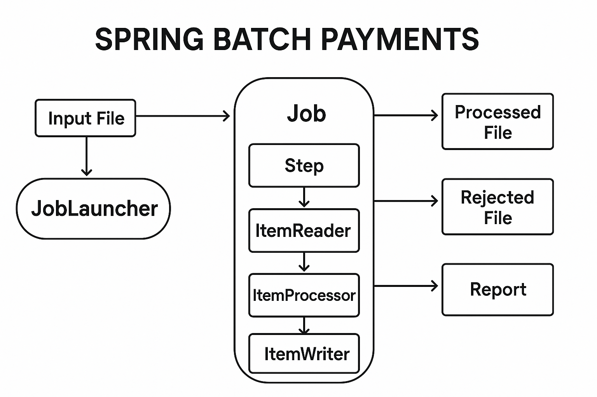
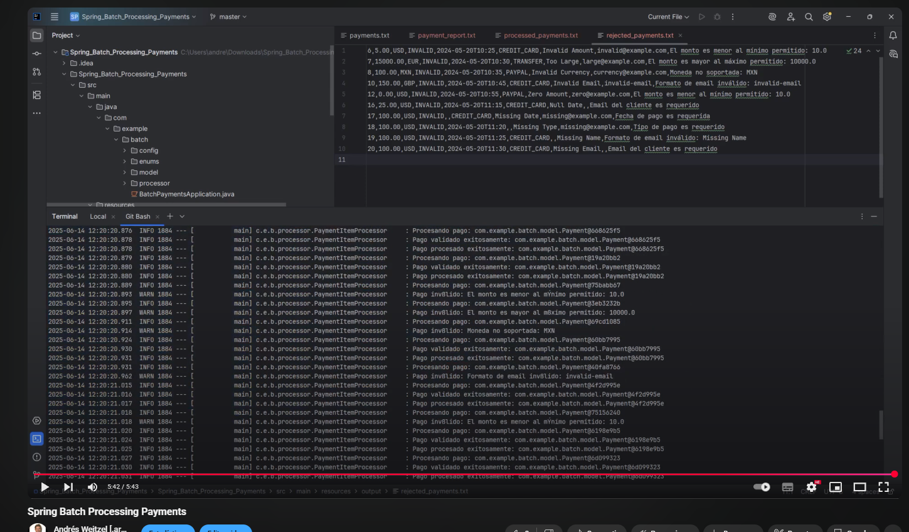

<div align = "center">
  
</div>


  <div align="right">
    
    
    
    
    
     
     
        
  </div>


<br>

<br>


<div align="right"> 
  <a href="https://github.com/andresWeitzel/Spring_Batch_Processing_Payments/blob/master/src/main/resources/static/translation/README.es.md">
    
  </a> 
  <a href="https://github.com/andresWeitzel/Spring_Batch_Processing_Payments/blob/master/README.md">
    
  </a> 
</div>

<br>

<br>

<div align="center">  

# Spring Batch Payments Processor 

</div>

Este proyecto implementa un procesador de pagos usando Spring Batch que valida y procesa pagos desde un archivo de entrada, generando archivos de salida para pagos procesados, rechazados y un reporte general.

*   [Video de pruebas funcionales](https://www.youtube.com/watch?v=zPqArsLfH7o) <a href="https://www.youtube.com/watch?v=zPqArsLfH7o" target="_blank"> </a>

<br>

## Índice 📜

<details>
  <summary> Ver detalles </summary>

<div align="right">

`Última actualización: 20/02/26` 

</div>

### Sección 1) Descripción, Configuración y Tecnologías

*   [1.0) Descripción del Proyecto.](#10-descripción-del-proyecto-)
*   [1.1) Ejecución del Proyecto.](#11-ejecución-del-proyecto-)
*   [1.2) Estructura del Proyecto.](#12-estructura-del-proyecto-)
*   [1.3) Tecnologías.](#13-tecnologías-)

### Sección 2) Flujo de Procesamiento, Formato de Archivos y Validaciones

*   [2.0) Flujo de Procesamiento.](#20-flujo-de-procesamiento-)
*   [2.1) Formato de Archivos.](#21-formato-de-archivos-)
*   [2.2) Validaciones Implementadas.](#22-validaciones-implementadas-)

### Sección 3) Ejemplos de Pagos

*   [3.0) Pagos Válidos.](#30-pagos-válidos-)
*   [3.1) Pagos Rechazados.](#31-pagos-rechazados-)

### Sección 4) Reportes, Pruebas Funcionales y Referencias

*   [4.0) Reportes.](#40-reportes-)
*   [4.1) Pruebas Funcionales.](#41-pruebas-funcionales-)
*   [4.2) Contribución.](#42-contribución-)
*   [4.3) Licencia.](#43-licencia-)

<br>

</details>

<br>

## Sección 1) Descripción, Configuración y Tecnologías

### 1.0) Descripción del Proyecto [🔝](#índice-)

<details>
   <summary>Ver detalles</summary>

  <br>

Este proyecto implementa un procesador de pagos usando Spring Batch que valida y procesa pagos desde un archivo de entrada, generando archivos de salida para pagos procesados, rechazados y un reporte general.

**Características:**

- Procesamiento de pagos en lotes
- Validación de montos, monedas y datos del cliente
- Cálculo de comisiones
- Generación de reportes
- Manejo de errores y pagos rechazados
- Soporte para múltiples monedas (USD, EUR, GBP, JPY)

<br>

</details>

### 1.1) Ejecución del Proyecto [🔝](#índice-)

<details>
   <summary>Ver detalles</summary>

  <br>

*   Creamos un entorno de trabajo a través de algún IDE, podemos o no crear una carpeta raíz para el proyecto, nos posicionamos sobre ella

```git
cd 'nombreCarpetaRaíz'
```

*   Una vez creado un entorno de trabajo, clonamos el proyecto

```git
git clone https://github.com/andresWeitzel/Spring_Batch_Processing_Payments
```

*   Nos posicionamos sobre el proyecto

```git
cd 'Spring_Batch_Processing_Payments'
```

*   Necesitamos [Java 17](https://www.oracle.com/java/technologies/javase/jdk17-archive-downloads.html) o superior instalado
*   Necesitamos [Maven 3.6](https://maven.apache.org/download.cgi) o superior instalado
*   Instalamos todas las dependencias necesarias

```git
mvn clean install
```

*   El proyecto utiliza diferentes perfiles para desarrollo y producción. Para ejecutar en modo desarrollo:

```git
mvn spring-boot:run -Dspring-boot.run.profiles=dev
```

*   Para ejecutar en modo producción:

```git
mvn spring-boot:run -Dspring-boot.run.profiles=prod
```

*   `Importante`: Es posible que haya otros pasos previos que no se hayan incluido por sincronización entre documentos en relación al desarrollo. Por favor, abre un hilo de conversación dentro de la sección 'Issues' del proyecto.

<br>

</details>

### 1.2) Estructura del Proyecto [🔝](#índice-)

<details>
   <summary>Ver detalles</summary>

  <br>

```
src/main/java/com/example/batch/
├── config/         # Configuración de Spring Batch
├── model/          # Modelos de datos
├── processor/      # Procesadores de pagos
└── enums/          # Enumeraciones
```

<br>

</details>

### 1.3) Tecnologías [🔝](#índice-)

<details>
   <summary>Ver detalles</summary>

  <br>

| **Tecnologías** | **Versión** | **Finalidad** |
| ------------- | ------------- | ------------- |
| [Java](https://www.oracle.com/java/technologies/javase/jdk17-archive-downloads.html) | 17+ | Lenguaje de Programación |
| [Spring Boot](https://spring.io/projects/spring-boot) | 2.7.0 | Framework de Aplicación |
| [Spring Batch](https://spring.io/projects/spring-batch) | 4.3.6 | Framework de Procesamiento por Lotes |
| [Maven](https://maven.apache.org/) | 3.6+ | Gestión de Dependencias y Compilación |
| [JUnit](https://junit.org/junit5/) | 5 | Framework de Pruebas Unitarias |
| [Postman](https://www.postman.com/downloads/) | 10+ | Cliente Http para Testing |
| [Swagger](https://swagger.io/) | 2.0 | Documentación de API |
| [Git](https://git-scm.com/downloads) | 2.29+ | Control de Versiones |
| Otros | - | Otros |

<br>

</details>

<br>

## Sección 2) Flujo de Procesamiento, Formato de Archivos y Validaciones

### 2.0) Flujo de Procesamiento [🔝](#índice-)

<details>
   <summary>Ver detalles</summary>

  <br>

1. **Lectura de Pagos**: Lee pagos desde `input/payments.txt`
2. **Validación y Procesamiento**: 
   - Valida montos (mínimo: 10.00, máximo: 10000.00)
   - Valida monedas soportadas
   - Valida formato de email
   - Calcula comisiones
3. **Escritura de Resultados**:
   - Pagos válidos → `output/processed_payments.txt`
   - Pagos rechazados → `output/rejected_payments.txt`
   - Reporte general → `output/payment_report.txt`

<br>

</details>

### 2.1) Formato de Archivos [🔝](#índice-)

<details>
   <summary>Ver detalles</summary>

  <br>

### 2.1.0) Archivo de Entrada (payments.txt)

```
id,amount,currency,status,paymentDate,paymentType,customerName,customerEmail
1,100.00,USD,PENDING,2024-03-20T10:00:00,CREDIT_CARD,John Doe,john@example.com
2,500.00,EUR,PENDING,2024-03-20T10:05:00,DEBIT_CARD,Jane Smith,jane@example.com
3,1000.00,GBP,PENDING,2024-03-20T10:10:00,CREDIT_CARD,Bob Johnson,bob@example.com
4,5000.00,JPY,PENDING,2024-03-20T10:15:00,DEBIT_CARD,Alice Brown,alice@example.com
```

<br>

### 2.1.1) Archivo de Pagos Procesados (processed_payments.txt)

```
id,amount,currency,status,paymentDate,paymentType,customerName,customerEmail,amountInUSD,commission,validationStatus
1,100.00,USD,PROCESSED,2024-03-20T10:00:00,CREDIT_CARD,John Doe,john@example.com,100.00,2.00,VALID
2,500.00,EUR,PROCESSED,2024-03-20T10:05:00,DEBIT_CARD,Jane Smith,jane@example.com,545.00,10.90,VALID
3,1000.00,GBP,PROCESSED,2024-03-20T10:10:00,CREDIT_CARD,Bob Johnson,bob@example.com,1270.00,25.40,VALID
4,5000.00,JPY,PROCESSED,2024-03-20T10:15:00,DEBIT_CARD,Alice Brown,alice@example.com,33.50,0.67,VALID
```

<br>

### 2.1.2) Archivo de Pagos Rechazados (rejected_payments.txt)

```
id,amount,currency,status,paymentDate,paymentType,customerName,customerEmail,errorMessage
5,5.00,USD,INVALID,2024-03-20T10:20:00,CREDIT_CARD,Charlie Wilson,charlie@example.com,El monto es menor al mínimo permitido: 10.0
6,15000.00,EUR,INVALID,2024-03-20T10:25:00,DEBIT_CARD,Diana Miller,diana@example.com,El monto excede el máximo permitido: 10000.0
7,200.00,MXN,INVALID,2024-03-20T10:30:00,CREDIT_CARD,Edward Davis,edward@example.com,Moneda no soportada: MXN
8,300.00,GBP,INVALID,2024-03-20T10:35:00,INVALID_TYPE,Frank Lee,frank@example.com,Tipo de pago no válido: INVALID_TYPE
9,400.00,USD,INVALID,2024-03-20T10:40:00,CREDIT_CARD,Grace Kim,invalid-email,Formato de email inválido
10,500.00,EUR,INVALID,2024-03-20T10:45:00,DEBIT_CARD,Henry Park,,Email no puede estar vacío
11,600.00,GBP,INVALID,2024-03-20T10:50:00,CREDIT_CARD,Ivy Chen,ivy@example.com,Fecha de pago inválida o vacía
```

<br>

### 2.1.3) Archivo de Reporte General (payment_report.txt)

```
=== Reporte de Procesamiento de Pagos ===
Fecha de Procesamiento: 2024-03-20T11:00:00
Total de Pagos Procesados: 4
Total de Pagos Rechazados: 7
Total de Pagos: 11

=== Estadísticas por Moneda ===
USD: 2 pagos (1 procesado, 1 rechazado)
EUR: 3 pagos (1 procesado, 2 rechazados)
GBP: 3 pagos (1 procesado, 2 rechazados)
JPY: 1 pago (1 procesado, 0 rechazados)
MXN: 1 pago (0 procesados, 1 rechazado)

=== Estadísticas por Tipo de Pago ===
CREDIT_CARD: 6 pagos
DEBIT_CARD: 4 pagos
INVALID_TYPE: 1 pago

=== Razones de Rechazo ===
Monto muy bajo: 1
Monto muy alto: 1
Moneda no soportada: 1
Tipo de pago inválido: 1
Email inválido: 2
Fecha inválida: 1

=== Montos Totales ===
Total Procesado (USD): 1948.40
Total Comisiones (USD): 38.97
```

<br>

</details>

### 2.2) Validaciones Implementadas [🔝](#índice-)

<details>
   <summary>Ver detalles</summary>

  <br>

1. **Monto**:
   - Mínimo: 10.00
   - Máximo: 10000.00

2. **Monedas Soportadas**:
   - USD (Dólar Americano)
   - EUR (Euro)
   - GBP (Libra Esterlina)
   - JPY (Yen Japonés)

3. **Email**:
   - Formato válido
   - No puede estar vacío

4. **Fecha de Pago**:
   - No puede estar vacía
   - Formato ISO 8601

<br>

</details>

<br>

## Sección 3) Ejemplos de Pagos

### 3.0) Pagos Válidos [🔝](#índice-)

<details>
   <summary>Ver detalles</summary>

  <br>

### 3.0.0) Pago en USD dentro del rango permitido

```
id,amount,currency,status,paymentDate,paymentType,customerName,customerEmail
1,100.00,USD,PENDING,2024-03-20T10:00:00,CREDIT_CARD,John Doe,john@example.com
2,500.00,USD,PENDING,2024-03-20T10:05:00,DEBIT_CARD,Jane Smith,jane@example.com
3,1000.00,USD,PENDING,2024-03-20T10:10:00,CREDIT_CARD,Bob Johnson,bob@example.com
```

<br>

### 3.0.1) Pago en EUR con email válido

```
id,amount,currency,status,paymentDate,paymentType,customerName,customerEmail
4,500.00,EUR,PENDING,2024-03-20T11:00:00,DEBIT_CARD,Jane Smith,jane.smith@example.com
5,750.00,EUR,PENDING,2024-03-20T11:05:00,CREDIT_CARD,Alice Brown,alice.brown@example.com
6,2500.00,EUR,PENDING,2024-03-20T11:10:00,DEBIT_CARD,Charlie Wilson,charlie.wilson@example.com
```

<br>

### 3.0.2) Pago en GBP con montos variados

```
id,amount,currency,status,paymentDate,paymentType,customerName,customerEmail
7,50.00,GBP,PENDING,2024-03-20T12:00:00,CREDIT_CARD,David Miller,david.miller@example.com
8,200.00,GBP,PENDING,2024-03-20T12:05:00,DEBIT_CARD,Eva Garcia,eva.garcia@example.com
9,5000.00,GBP,PENDING,2024-03-20T12:10:00,CREDIT_CARD,Frank Lee,frank.lee@example.com
```

<br>

### 3.0.3) Pago en JPY con diferentes tipos de pago

```
id,amount,currency,status,paymentDate,paymentType,customerName,customerEmail
10,10000.00,JPY,PENDING,2024-03-20T13:00:00,CREDIT_CARD,Grace Kim,grace.kim@example.com
11,50000.00,JPY,PENDING,2024-03-20T13:05:00,DEBIT_CARD,Henry Park,henry.park@example.com
12,100000.00,JPY,PENDING,2024-03-20T13:10:00,CREDIT_CARD,Ivy Chen,ivy.chen@example.com
```

<br>

</details>

### 3.1) Pagos Rechazados [🔝](#índice-)

<details>
   <summary>Ver detalles</summary>

  <br>

### 3.1.0) Montos muy bajos

```
id,amount,currency,status,paymentDate,paymentType,customerName,customerEmail
13,5.00,USD,PENDING,2024-03-20T14:00:00,CREDIT_CARD,Jack Wilson,jack@example.com
14,1.00,EUR,PENDING,2024-03-20T14:05:00,DEBIT_CARD,Kate Brown,kate@example.com
15,0.50,GBP,PENDING,2024-03-20T14:10:00,CREDIT_CARD,Liam Davis,liam@example.com
```

<br>

### 3.1.1) Monedas no soportadas

```
id,amount,currency,status,paymentDate,paymentType,customerName,customerEmail
16,1000.00,MXN,PENDING,2024-03-20T15:00:00,DEBIT_CARD,Maria Garcia,maria@example.com
17,500.00,CAD,PENDING,2024-03-20T15:05:00,CREDIT_CARD,Noah Smith,noah@example.com
18,2000.00,AUD,PENDING,2024-03-20T15:10:00,DEBIT_CARD,Olivia Lee,olivia@example.com
```

<br>

### 3.1.2) Emails inválidos

```
id,amount,currency,status,paymentDate,paymentType,customerName,customerEmail
19,200.00,USD,PENDING,2024-03-20T16:00:00,CREDIT_CARD,Peter Davis,invalid-email
20,300.00,EUR,PENDING,2024-03-20T16:05:00,DEBIT_CARD,Quinn Wilson,not-an-email
21,400.00,GBP,PENDING,2024-03-20T16:10:00,CREDIT_CARD,Rachel Brown,missing@domain
```

<br>

### 3.1.3) Montos muy altos

```
id,amount,currency,status,paymentDate,paymentType,customerName,customerEmail
22,15000.00,USD,PENDING,2024-03-20T17:00:00,DEBIT_CARD,Sam Miller,sam@example.com
23,20000.00,EUR,PENDING,2024-03-20T17:05:00,CREDIT_CARD,Tina Garcia,tina@example.com
24,25000.00,GBP,PENDING,2024-03-20T17:10:00,DEBIT_CARD,Victor Lee,victor@example.com
```

<br>

### 3.1.4) Fechas inválidas o vacías

```
id,amount,currency,status,paymentDate,paymentType,customerName,customerEmail
25,100.00,USD,PENDING,,CREDIT_CARD,Will Smith,will@example.com
26,200.00,EUR,PENDING,invalid-date,DEBIT_CARD,Xena Brown,xena@example.com
27,300.00,GBP,PENDING,2024-13-45T25:61:99,CREDIT_CARD,Yara Davis,yara@example.com
```

<br>

### 3.1.5) Tipos de pago inválidos

```
id,amount,currency,status,paymentDate,paymentType,customerName,customerEmail
28,100.00,USD,PENDING,2024-03-20T18:00:00,INVALID_TYPE,Zack Wilson,zack@example.com
29,200.00,EUR,PENDING,2024-03-20T18:05:00,UNKNOWN,Anna Brown,anna@example.com
30,300.00,GBP,PENDING,2024-03-20T18:10:00,,Bob Davis,bob@example.com
```

<br>

</details>

<br>

## Sección 4) Reportes, Pruebas Funcionales y Referencias

### 4.0) Reportes [🔝](#índice-)

<details>
   <summary>Ver detalles</summary>

  <br>

El sistema genera tres tipos de archivos de salida:

1. **processed_payments.txt**: Contiene todos los pagos válidos procesados con comisiones calculadas y montos convertidos a USD.
2. **rejected_payments.txt**: Contiene los pagos que fallaron en la validación junto con el mensaje de error correspondiente.
3. **payment_report.txt**: Reporte general con estadísticas de procesamiento incluyendo estadísticas por moneda, por tipo de pago, razones de rechazo y montos totales.

<br>

</details>

### 4.1) Pruebas Funcionales [🔝](#índice-)

<details>
   <summary>Ver detalles</summary>

  <br>

#### [Ver video](https://www.youtube.com/watch?v=zPqArsLfH7o)

  <a href="https://www.youtube.com/watch?v=zPqArsLfH7o">
    
  </a> 

<br>

</details>

### 4.2) Contribución [🔝](#índice-)

<details>
   <summary>Ver detalles</summary>

  <br>

1. Fork el proyecto
2. Crea una rama para tu feature (`git checkout -b feature/AmazingFeature`)
3. Commit tus cambios (`git commit -m 'Add some AmazingFeature'`)
4. Push a la rama (`git push origin feature/AmazingFeature`)
5. Abre un Pull Request

<br>

</details>

### 4.3) Licencia [🔝](#índice-)

<details>
   <summary>Ver detalles</summary>

  <br>

Este proyecto está bajo la Licencia MIT - ver el archivo [LICENSE](LICENSE) para más detalles.

<br>

</details>
